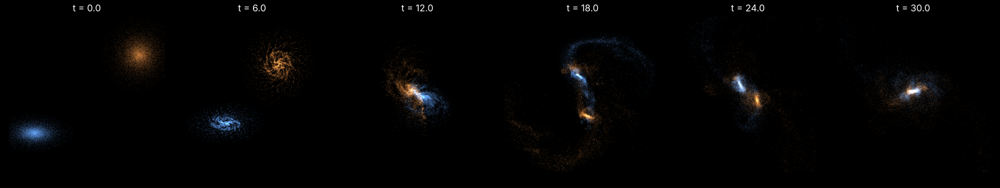
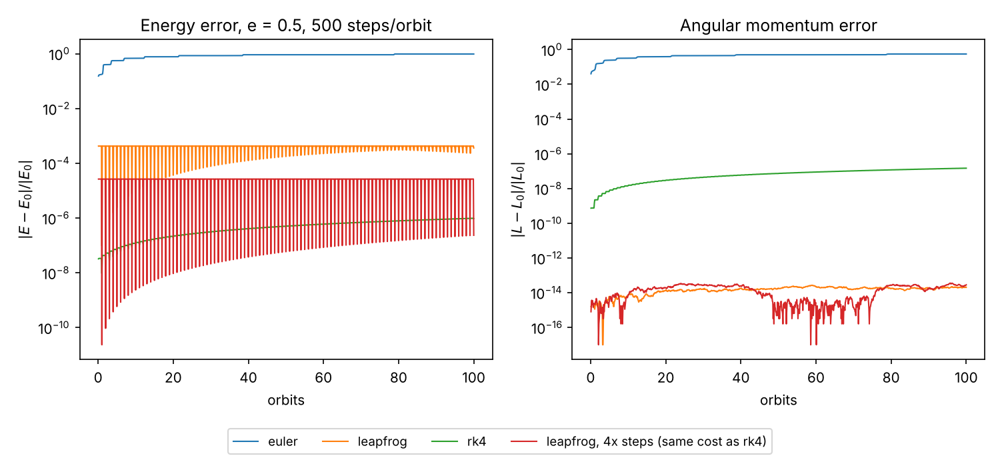
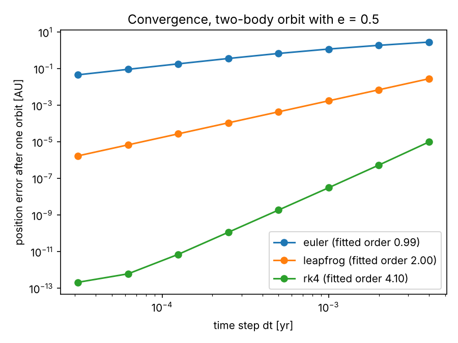
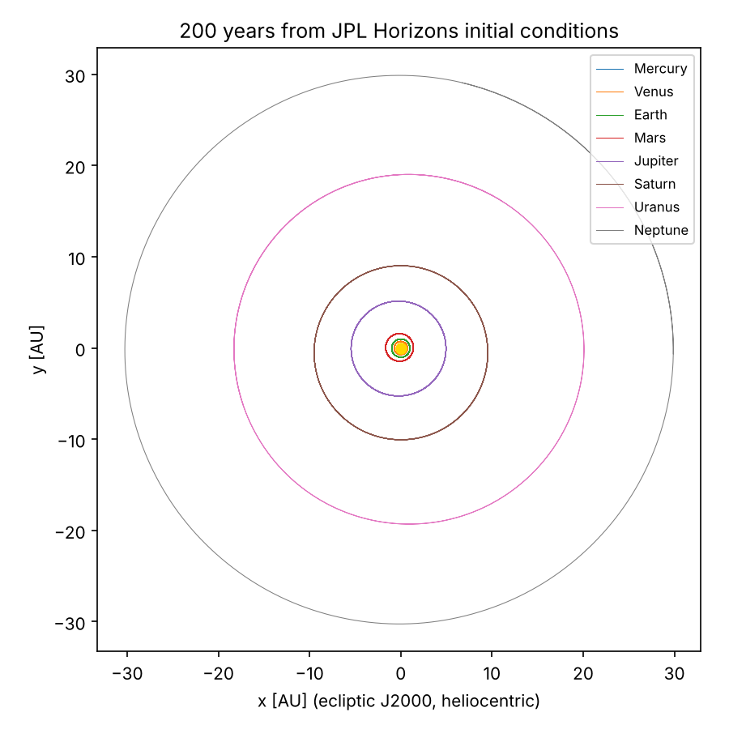
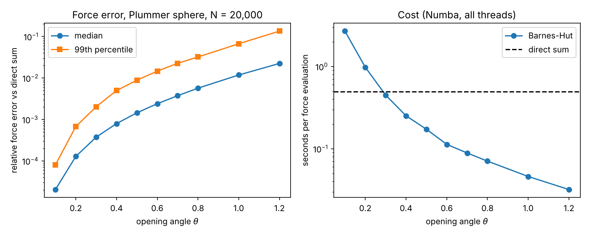
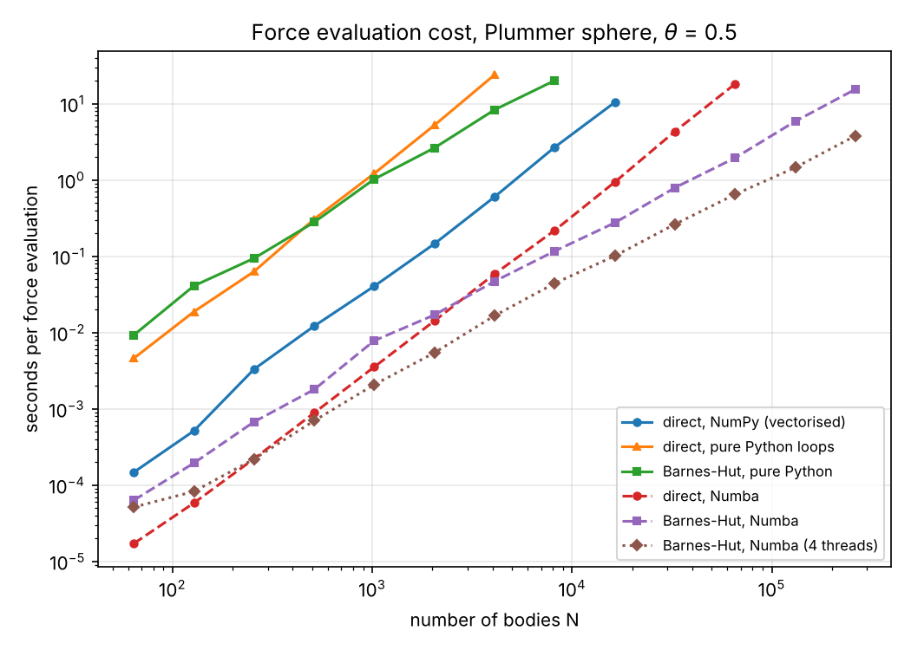

# N-body gravity simulator

A Newtonian gravity simulator in Python. Bodies attract each other, and the program steps
time forward. It runs the real solar system from NASA JPL data and scales to a
100,000-body galaxy collision using a Barnes-Hut octree compiled with Numba.

**Live demo: <https://jqin110-tech.github.io/nbody-gravity-simulator/>** (a simulation that
runs in your browser, plus playback of the 100,000-body run).



**Every number in this file is printed by `python -m scripts.summary`**, which reads the
JSON files that the stage scripts write to `results/`. Timings were measured on one 4-CPU
Linux cloud machine (Python 3.13, NumPy 2.5, Numba 0.68) and will differ on yours.

## What is in it

| Part | File | What it does |
|---|---|---|
| Forces | `nbody/forces.py` | Exact O(N²) direct sum with Plummer softening, vectorised with NumPy |
| Integrators | `nbody/integrators.py` | Explicit Euler, leapfrog (kick-drift-kick) and RK4 behind one function signature |
| Diagnostics | `nbody/diagnostics.py` | Total energy, angular momentum, linear momentum |
| Exact solution | `nbody/twobody.py` | Kepler orbits, used as the known answer in tests |
| Real data | `nbody/solar_system.py` | Loads JPL Horizons vectors and DE440 masses from `data/raw/` |
| Barnes-Hut | `nbody/barnes_hut.py` | Octree in flat arrays; the same code runs as pure Python or compiled by Numba |
| Models | `nbody/initial_conditions.py` | Plummer sphere, exponential disc, parabolic encounter |
| Viewer | `viewer/` | TypeScript + Canvas: a live in-browser simulation, and a player for the recorded run |

Units are AU, years and solar masses, so G = 4π² (see `nbody/constants.py`). The galaxy
demo uses N-body units with G = 1.

## How to run it

```bash
python -m venv .venv && source .venv/bin/activate
pip install -r requirements.txt          # numpy, matplotlib, pytest, numba

python -m pytest                         # 46 physics tests

python -m scripts.stage2_kepler          # each script prints its results and
python -m scripts.stage2_energy          # writes JSON + PNG to results/
python -m scripts.stage2_convergence
python -m scripts.stage3_solar_system
python -m scripts.stage4_profile
python -m scripts.stage4_theta
python -m scripts.stage4_benchmark       # the slowest of the Stage 2-4 scripts
python -m scripts.stage5_galaxy          # 29.5 minutes on 4 CPUs; add --quick for a small test run
python -m scripts.stage5_render          # needs ffmpeg for the video
python -m scripts.summary                # prints every number in this README
```

The viewer:

```bash
cd viewer && npm install && npm test     # compiles the TypeScript and runs 7 physics tests
python -m http.server 8000               # then open http://localhost:8000
```

`python scripts/fetch_horizons.py` re-downloads the NASA data (standard library only).

## Results

### Stage 2: is it right?

**Kepler's third law.** Eight two-body orbits (a from 0.5 to 10 AU, total mass 1 to 11 M☉,
eccentricity 0 to 0.6) were simulated with leapfrog at 20,000 steps per orbit. The worst
relative error in the measured period against T = 2π√(a³/GM) is **1.07e-06**.

**Energy and angular momentum** over 100 orbits with e = 0.5 and 500 steps per orbit:

| Integrator | max \|ΔE/E\| | in the first 10% | in the last 10% | max \|ΔL/L\| |
|---|---|---|---|---|
| Euler | 9.72e-01 | 6.77e-01 | 9.72e-01 | 5.53e-01 |
| Leapfrog | 4.29e-04 | 4.26e-04 | 4.29e-04 | 2.68e-14 |
| RK4 | 9.74e-07 | 1.19e-07 | 9.74e-07 | 1.47e-07 |
| Leapfrog with 4× the steps (same cost as RK4) | 2.66e-05 | 2.66e-05 | 2.66e-05 | 3.59e-14 |



Euler's energy error grows until the orbit is destroyed. Leapfrog's is the same size at
the end as at the start. RK4's is smaller but grows steadily. Note that at equal cost RK4
is still more accurate than leapfrog over these 100 orbits; leapfrog's advantage is that
its error does not accumulate.

**Convergence order.** Position error after one orbit (e = 0.5) against the exact Kepler
solution, for 250 to 32,000 steps per orbit:

| Integrator | Expected order | Fitted order | Error ratio each time dt is halved |
|---|---|---|---|
| Euler | 1 | 0.99 | 1.50, 1.60, 1.74, 1.88, 1.96, 1.99, 2.00 |
| Leapfrog | 2 | 2.00 | 4.01, 4.00, 4.00, 4.00, 4.00, 4.00, 4.00 |
| RK4 | 4 | 4.10 | 18.36, 17.25, 16.65, 16.34, 16.16, 11.60, 2.89 |



Euler only reaches its 2× ratio at small steps, and RK4's last two ratios fall because its
error has reached floating-point round-off (about 1e-12 AU). The orders are fitted inside
the windows set in `scripts/stage2_convergence.py` (Euler: 4,000 steps and up; RK4: up to
4,000 steps); the plot shows every point.

### Stage 3: the real solar system

Initial conditions are the Sun and the barycentres of the eight planetary systems at
2025-01-01 00:00 TDB from JPL Horizons, with masses from DE440 GM values. The system was
run for 200 years with leapfrog at dt = 0.0625 days, and each period is the average time
per complete heliocentric orbit.

| Planet | Simulated (days) | NASA sidereal (days) | Relative error | Orbits averaged |
|---|---|---|---|---|
| Mercury | 87.970 | 87.969 | +9.8e-06 | 830 |
| Venus | 224.701 | 224.701 | -1.8e-08 | 325 |
| Earth | 365.257 | 365.256 | +1.7e-06 | 199 |
| Mars | 686.977 | 686.980 | -3.7e-06 | 106 |
| Jupiter | 4332.815 | 4332.589 | +5.2e-05 | 16 |
| Saturn | 10756.097 | 10755.699 | +3.7e-05 | 6 |
| Uranus | 30682.485 | 30685.400 | -9.5e-05 | 2 |
| Neptune | 60197.474 | 60189.018 | +1.4e-04 | 1 |

The worst error is **1.4e-04**. Energy is conserved to 1.0e-08 over the run (1,168,822
steps, 34 s). Halving the time step changes no period by more than 2.2e-05, so the time
step is not what limits the agreement. The outer planets agree least because only one or
two of their orbits fit in 200 years, and a single orbit perturbed by Jupiter and Saturn
is not the long-term mean that NASA lists.



**Sidereal, not tropical.** The "Orbital Period" row of NASA's summary Planetary Fact
Sheet is the tropical period (equinox to equinox), as its notes page states
(`data/raw/nssdc_notes.html`). Against that value Neptune would appear to be off by
+6.65e-03. A simulation in a fixed frame measures the sidereal period, so the comparison
uses the sidereal periods on each planet's own fact sheet.

### Stage 4: making it fast

**Profile first.** For 2,000 bodies in pure Python, the Barnes-Hut tree walk takes 98.9%
of the 2.55 s (`results/stage4_profile.txt`). That loop cannot be vectorised with NumPy
because each body takes a different path through the tree, so it was compiled with Numba.

**Force error against the opening angle θ**, for a 20,000-body Plummer sphere, compared
with the exact direct sum. Both are compiled with Numba and use 4 threads; the direct sum
takes 0.49 s.

| θ | Median error | 99th percentile | Max | Seconds | Speed-up vs direct sum |
|---|---|---|---|---|---|
| 0.1 | 2.0e-05 | 8.1e-05 | 7.6e-04 | 2.692 | 0.2x |
| 0.2 | 1.3e-04 | 6.7e-04 | 3.5e-03 | 0.980 | 0.5x |
| 0.3 | 3.8e-04 | 2.0e-03 | 7.8e-03 | 0.449 | 1.1x |
| 0.4 | 7.9e-04 | 5.0e-03 | 3.3e-02 | 0.252 | 2.0x |
| 0.5 | 1.4e-03 | 8.9e-03 | 5.9e-02 | 0.173 | 2.9x |
| 0.6 | 2.4e-03 | 1.5e-02 | 1.0e-01 | 0.113 | 4.4x |
| 0.7 | 3.8e-03 | 2.3e-02 | 1.4e-01 | 0.089 | 5.6x |
| 0.8 | 5.7e-03 | 3.2e-02 | 1.9e-01 | 0.071 | 7.0x |
| 1.0 | 1.2e-02 | 6.7e-02 | 2.9e-01 | 0.046 | 10.8x |
| 1.2 | 2.2e-02 | 1.4e-01 | 5.5e-01 | 0.032 | 15.5x |



The maximum errors are large because they are relative: they occur for bodies where pulls
from opposite sides nearly cancel, so the true net force is small.

**Runtime against N.** Seconds for one force evaluation at θ = 0.5. All columns but the
last use one thread.

| N | Direct, NumPy | Direct, pure Python | Barnes-Hut, pure Python | Direct, Numba | Barnes-Hut, Numba | Barnes-Hut, Numba, 4 threads |
|---|---|---|---|---|---|---|
| 64 | 0.000148 | 0.00461 | 0.0093 | 1.73e-05 | 6.36e-05 | 5.18e-05 |
| 128 | 0.000518 | 0.0189 | 0.0411 | 5.87e-05 | 0.000196 | 8.31e-05 |
| 256 | 0.00333 | 0.0634 | 0.0945 | 0.000223 | 0.000679 | 0.000221 |
| 512 | 0.0122 | 0.308 | 0.281 | 0.000891 | 0.0018 | 0.000702 |
| 1,024 | 0.0408 | 1.22 | 1.03 | 0.00357 | 0.00788 | 0.00209 |
| 2,048 | 0.146 | 5.25 | 2.64 | 0.0143 | 0.0171 | 0.00547 |
| 4,096 | 0.604 | 24 | 8.35 | 0.0588 | 0.0472 | 0.0167 |
| 8,192 | 2.7 | - | 20.2 | 0.219 | 0.117 | 0.0445 |
| 16,384 | 10.5 | - | - | 0.943 | 0.276 | 0.101 |
| 32,768 | - | - | - | 4.35 | 0.796 | 0.264 |
| 65,536 | - | - | - | 18.2 | 1.96 | 0.649 |
| 131,072 | - | - | - | - | 5.9 | 1.46 |
| 262,144 | - | - | - | - | 15.5 | 3.81 |



Measured crossover points:

- **Pure-Python Barnes-Hut never beats NumPy's direct sum** in the measured range. At
  N = 8,192 it takes 20.2 s against 2.7 s. The better algorithm loses because its inner
  loop runs in the interpreter while NumPy's runs in compiled code.
- Pure-Python Barnes-Hut beats a pure-Python direct sum from between N = 256 and N = 512.
- With both compiled by Numba, direct sum is faster at N = 2,048 and Barnes-Hut is faster
  at N = 4,096 and above. At N = 65,536 Barnes-Hut takes 1.96 s against 18.2 s.

**Numba before and after.** The same Barnes-Hut code runs **131× to 210×** faster compiled
than interpreted (one thread, N = 64 to 8,192). Compile time is excluded from all timings.

### Stage 5: a galaxy collision

Two equal galaxies, each a Plummer-sphere halo (75% of the mass) plus an exponential disc
(25%), approach on a parabolic orbit with the second disc tilted by 60°. Disc particles
start on circular orbits computed from the code's own Barnes-Hut forces.

- **100,000 bodies** (40,000 in the discs), **3,000 leapfrog steps**, θ = 0.7, softening 0.03, dt = 0.01 (N-body units, G = 1).
- Wall time **29.5 minutes**, 0.59 s per step, on 4 threads.
- Total energy, computed exactly (O(N²)) at the start and end, changed by **2.7e-03**; total angular momentum changed by 3.2e-03.

The discs grow spiral arms, pass through each other, throw out tidal tails and merge.

- Video: [`results/stage5_galaxy.mp4`](results/stage5_galaxy.mp4) (301 frames).
- Recorded playback: the web viewer plays 151 frames of a 15,000-body sample with
  play/pause, a scrub bar and a speed control.

### The live browser simulation

The page at the [live demo](https://jqin110-tech.github.io/nbody-gravity-simulator/) opens on
a simulation that is computed in the browser while you watch, so it never repeats.
`viewer/src/physics.ts` is the same method as the Python core, written in TypeScript:
softened direct-sum gravity and leapfrog kick-drift-kick. It starts with one galaxy (a heavy
central body plus a 1,000-body exponential disc on circular orbits) and a button sends in a
second, tilted galaxy on a parabolic orbit. You can drag to turn the view and scroll to zoom.
The page shows the running energy drift, so the conservation check is visible live.

`viewer/test/physics.test.mjs` checks the TypeScript physics the same way the Python is
checked: Newton's law for two bodies, a circular orbit closing after one Kepler period,
second-order convergence, bounded energy, and conserved momentum. It uses direct sum, not
Barnes-Hut, so it is limited to a few thousand bodies; the 100,000-body run stays in Python.
`.github/workflows/pages.yml` builds the viewer and deploys it to GitHub Pages.

## Limitations

- **Newtonian gravity only.** No general relativity, so for example Mercury's relativistic
  perihelion shift is absent. Each planet and its moons are one point at their barycentre,
  and asteroids are left out.
- **The solar-system check is on periods, over 200 years.** Positions were not compared
  with JPL's ephemeris at later dates, which would be a stricter test.
- **One fixed time step for every body.** There are no adaptive or individual time steps,
  so close encounters are only handled by softening.
- **Barnes-Hut uses the monopole term only.** There is no quadrupole correction, so
  accuracy is controlled by θ alone, and individual bodies can have errors of several
  percent at θ = 0.5 where the net force is small. Tree forces are not exactly equal and
  opposite, so total momentum is not conserved to round-off as it is with the direct sum.
- **The tree is simple, not tuned.** It is rebuilt from scratch every step, holds one body
  per leaf, and bodies are not sorted for memory locality. Two bodies at exactly the same
  position raise an error.
- **The galaxy is a demonstration, not a model of real galaxies.** The discs start cold
  and are not in exact equilibrium, so they form clumps before the collision. Halo
  particles are heavier than disc particles. The sizes, mass split and orbit are choices
  made for a clear picture, and the units are not physical.
- **Benchmarks come from one shared cloud machine**, so expect different absolute numbers
  elsewhere. Small-N timings (under a millisecond) are the noisiest.
- **The live browser simulation is small.** It uses the O(N²) direct sum on one thread, so
  it handles a few thousand bodies, and its galaxy is dominated by one heavy central body
  to stay stable at that size. Its speed depends on the visitor's device.
- The recorded playback shows a random 15,000-body sample in a 2D projection.

## Sources

| What | Source |
|---|---|
| Positions and velocities, 2025-01-01 00:00 TDB | NASA JPL Horizons API (ephemeris DE441), saved in `data/raw/horizons_*.txt` |
| GM of the Sun and planetary systems | JPL Solar System Dynamics, Astrodynamic Parameters page (DE440; Park et al. 2021, AJ 161, 105), `data/raw/jpl_astro_par.html` |
| Sidereal and tropical orbit periods | NASA NSSDC planetary fact sheets (D. R. Williams), `data/raw/nssdc_*.html` |
| Gaussian gravitational constant k | IAU (1976) System of Astronomical Constants |
| Plummer sphere | Plummer (1911, MNRAS 71, 460); sampling from Aarseth, Hénon & Wielen (1974, A&A 37, 183) |
| Exponential disc | Freeman (1970, ApJ 160, 811) |
| Parabolic galaxy encounters | Toomre & Toomre (1972, ApJ 178, 623) |
| Tree algorithm | Barnes & Hut (1986, Nature 324, 446) |

URLs and the download time of every file in `data/raw/` are in `data/raw/manifest.json`.
